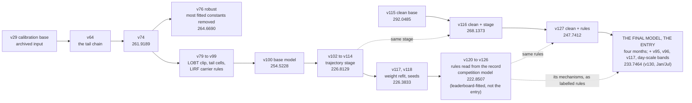

# The final model, the competition model, their lineage, and how to rebuild each

2026-10-08. **The entry is the final model** (first section below): no value fitted to a leaderboard score, run on the
four months of the final phase. **The competition model**, v126, is the same design pushed with everything the
leaderboard offered; `REPRODUCE.md` section 9 lists what was fitted.

From v100 on, every build script asserts its own sha256 against the shipped parquet, so a silent drift fails loudly
instead of shipping, and `FIRE=0` reproduces its base byte-identically; v64 to v99 assert their inputs,
and `scripts/regen_chain.sh` compares their outputs by value. `submissions/SHA256SUMS` lists every shipped file, and
`scripts/verify.sh` checks them.

## The lineage at a glance

Scores are RMSE on the 2026 set (January and July). Solid arrows are the submitted chain; the clean branch rebuilds the same architecture
and applies the same rules without any constant fitted to leaderboard scores (dotted arrows: the same stage, the same
rules).



---

## THE FINAL MODEL: `quick-boat_final.parquet`, January and July 233.7464

```
  rebuild   scripts/final/run_final.sh, twelve steps on final_ranking.parquet (REPRODUCE.md section 14, FINAL.md)
  sha256    97f3819fcc04c1f4f2994acaaeb509fa89315944841c5340fcfb8b3109df9cab   (670,790 rows, four months)
  scored    233.7464   its January and July rows as quick-boat_v130 (scripts/final/read3_build.py), board
            2026-10-08 21:15:20Z; pre-registered 239.25 [232.60, 245.73]. February and June: no feedback
  beside it quick-boat_final_with_v126.parquet: January and July from v126, February and June from the final model
            sha256 16cfd173334db2ae9d28924217a04047700d739965d36f380a175e121dbca2f9
```

The clean design (v127 below), retrained once on the twelve 2025 files and run on all four months. It adds the
chain's two LIRF cells whose evidence is labelled (v95's stands, v96's carriers), v117's blend weight refitted on the
window, and LIRF day-scale bands at their 2025 rates. February and June take month offsets from the twelve-month
cross-fit. Every value on its path, with its source, is in `FINAL.md`.

## THE COMPETITION MODEL: `quick-boat_v126.parquet`, 222.8507

```
  rebuild   section 11's inputs in place, then (REPRODUCE.md section 13)
              CONTROL=1 scripts/regen_seeds.sh     v100 -> v117 with the shipped seeds, byte for byte
              scripts/v118_build.sh                v118 from the archived seeds (artifacts/seeds)
              scripts/v120_build.py, scripts/v121_build.py
              v122_build.py to v126_build.py (inputs archived in artifacts/fable; scripts/fable_lirf/run_all.sh regenerates)
  sha256    d66768fe3504ddcc6ed0bbf9a0e97bfff5d9e353e73bc4e4a4b170a079b6a951
  scored    222.8507   board 2026-10-04 16:32Z
  verified  2026-10-02/03 in the author's tree: v117 and v119 to v126 to their recorded sha256, every FIRE=0 control,
            v118 against its sha256 from the seed chain; a clean room without the adsb.lol pull rebuilt v100 to v121
            byte for byte (2026-10-02); scripts/fable_lirf/run_all.sh, from an empty directory, reproduced v123's
            and v125's archived inputs byte for byte (2026-10-03)
```

v126 is the trajectory stage below (v114) with nine changes, each pre-registered with a predicted score and a kill line:

```
  v117  226.5352   the stage's blend weight on covered rows refitted outside LIRF, 0.662 -> 0.837
  v118  226.3833   more seeds on the scored side: K128 8 -> 18, CL 2 -> 10, L55A 3 -> 10 (nothing refitted)
  v120  225.9972   THY at LIRF: its feed was down in January 2026 by its own labelled arrivals (38 of 38 early
                   arrivals copied), so its January departures move to the schedule copy at the 2025 failure's rate
  v121  225.9576   departures inside 2026 outage spans (runs of five or more copied early arrivals of a carrier),
                   by whether the carrier's departures followed its arrivals in 2025
  v122  224.7674   the flight-plan join rule: a plan attaches only when |BLOCK - LOBT| <= 3606 s. Every prediction
                   with a plan clipped onto MVT - LOBT +- 3606; LIRF departures without one whose plan is recovered
                   from their arrival at the destination and took off > 3606 s after it are real: MVT - AOBT_3
  v123  223.5285   a copy classifier for LIRF's no-plan, 1-4 h delayed coin flip, built from the provided data only
  v124  222.9558   the rule's second case: no plan, took off within 3606 s of the recovered LOBT -> y > MVT - LOBT +
                   3606; raised to that floor, and moved toward the copy at 21/23 where ms allows
  v125  222.9161   LIRF's local-time record class (the off-block one UTC offset early) for no-plan rows with ms < 1800
  v126  222.8507   LIRF no-plan rows delayed 30,000-86,000 s are never real (2025): clip(ms) below 46,800 s, a floor
                   above; corrupted identifiers left out
```

v122 to v126 come from a separate AI agent session (two rounds) given only the challenge's files and our predictions
(`scripts/fable_lirf/`); the join rule was re-derived with independent code before it was built, the classifier and the
class rates checked for label use. They paid 1.42, 0.955, 1.11, 0.11 and 1.00 times the squared size of their changes. The two feed rules read the scored months' arrivals, which keep their labels, and nothing fitted on the scored departures.
v120 paid -dSSE = 1.016 Q, every moved row a copy. v121 paid +0.0396, 7% of its expected gain; replayed on the window
with ten-month classes it costs 1.3212e7 [-8.822e7, +4.295e7], and there it reaches only carriers with their own 2025
rate (KMM, MEA, GFA), so the class-rate arm that moved 73 of its 81 rows in 2026 has no window test. The rules exactly:
`REPRODUCE.md` section 13; the evidence: the paper's Sections 4.6 and 5.3.

What each change after the stage rests on (the paper's Section 5.3). None carries a weight fitted to a score on the 2026 set:

| change | rows moved on the 2026 set | labelled 2025 evidence | read from the scored months |
|---|---:|---|---|
| v118 more seeds in three members | every row | the seeds' spread on the scored rows | no label |
| v120 THY's feed | 118 | 241 of 243 THY departures copied in November and December | THY's early arrivals, 38 of 38 copied in January |
| v121 outage spans by carrier class | 81 | 25 of 36 carriers' departures followed their arrivals | outage spans in the arrivals |
| v122 join bound | 29 | `BLOCK - LOBT` within 3,606 s on all 2,062,577 departures with a plan | |
| v122 recovered plans, first case | 22 | 76 of 76 real | |
| v123 coin-flip classifier | 271 | 1,248 departures, 46.0% copies | the carrier's arrival copy rate |
| v124 recovered plans, second case | 14 | 21 of 23 copies where `ms` allows; no row below the floor | |
| v125 local-time class | 27 | 20 of 76 | |
| v126 day-scale floor | 6 | 45 rows: 36 copies, 9 date errors, none real | |

## THE TRAJECTORY STAGE AS FIRST SUBMITTED: `quick-boat_v114.parquet`, 226.8129

```
  rebuild   PULL=1 FROM_DAYS=1 scripts/regen_adsb.sh    (once; afterwards scripts/regen_adsb.sh)
  sha256    7ec3f9d66202f64766d087512cea26aa945fa08eb541b2853033fdbc84381e2b
  scored    226.8129   board 2026-09-28 16:05Z
  verified  each of v102 to v114 byte-identical from the archived tables and members when it was added to the
            driver (author's tree, 2026-09-24 to 09-28); the clean-room run needs the pull and is pending
```

v114 is the base model below (v100) with a stage on raw ADS-B surface tracks from the open adsb.lol archive, in
three layers: a residual stage on v100 trained on January and July 2025, full-year tree members that replace v100's
bulk on covered rows, and a full-year stage on their out-of-fold residuals. LIRF keeps the first layer only. The
stage changes rows with a detected pushback where v100 does not predict the schedule copy. `README.md` section 2
describes it and `REPRODUCE.md` section 11 rebuilds it.

## THE CLEAN REBUILD: `quick-boat_v116.parquet`, 268.1373, and its base `quick-boat_v115.parquet`, 292.0485

```
  rebuild   scripts/regen_clean.sh, then scripts/v115_v116_build.sh (SKIP_REGEN=1 reuses the first)
  sha256    v115 00bf453efc80d6d5805332ef81c3becde0d28da0e8ad7f35a2ad622009ebf8e4
            v116 a460c540c9d36e7930b2695f8b1c30533b70bcba5c21de14a8baa1884257a9c7
  scored    292.0485 and 268.1373   board 2026-09-30 17:40Z and 17:43Z
  verified  2026-09-30: two runs into separate directories byte-identical at every step
```

The same architecture without the constants fitted to the leaderboard: the learned five-class gate on the scored rows instead of
the hand-built chain, labelled month offsets, and the trajectory stage re-priced on that base by the same rules
(`REPRODUCE.md` section 12). The stage removes almost exactly the same squared error on the 2026 set from either base
(4.6190e9 against 4.5994e9). The bases score 37.53 s apart; their predictions differ mainly on 225 rows, 174 at LIRF,
where the submitted chain enforces rules the learned mixture does not and carries the leaderboard constants of
`REPRODUCE.md` section 9.

## THE CLEAN RULES: `quick-boat_v127.parquet`, 247.7412

```
  rebuild   scripts/v127_build.sh (needs the v116 run of scripts/regen_clean.sh in $DC26_WORK/clean)
  sha256    74fcf296d1ee90b08cfa6ce7b7356a8b82143ccf51dd2b87e1754925938f4d12
  scored    247.7412   board 2026-10-05 12:53Z; pre-registered 246.41, kill line 257.89
  verified  2026-10-05: two runs byte-identical; v120 to v126 still reproduce their own shas in default mode
```

v116 with the rule scripts of v117 and v120 to v126 re-run unchanged on it, in a CLEAN mode that takes the base as an
input; the bulk the v120 and v121 hedges blend toward uses the clean chain's labelled month offsets. v117's own rule did
not pass on the clean chain (G/SE +0.97 against its bar of 1), so it is not applied; v118's extra seeds are not re-applied.
The rules removed 3.6284e9 of squared error from v116, 0.941 times the prediction made from what each paid on the
submitted chain. So with no constant fitted to leaderboard scores anywhere, these rules score 247.7412; the 24.89
between them and v126 is the hand-built tail chain and its constants, with v118's seeds, together.

## BASE, AND THE DELIVERABLE WITHOUT TRAJECTORY DATA: `quick-boat_v100.parquet`, 254.5228

```
  rebuild   uv run --quiet --with pandas --with numpy --with pyarrow python scripts/v100_build.py
  sha256    30ca298a56825a78762312936b39229f32c1fdc7dab2659ecd7f69957f939332
  scored    254.5228   board 2026-09-23 02:35Z
  verified  2026-09-23: byte-identical from the archived members, in the author's tree and in a clean room
```

`v100 = v99` with the bulk blend refitted as nine members whose weights were fitted out of fold on labelled 2025
data, applied only where v99 does not already predict the schedule copy. Its board result was
predicted beforehand at 254.9175 +- 0.585 by the deployed-level estimator (`scripts/p1a_instrument.py`) and paid 254.5228. Members,
weights and the from-scratch path: `REPRODUCE.md` section 8.

## The lineage, as scored on the public board

The trajectory stage, v100 to v114. Each change was pre-registered with a predicted score and a kill line before
upload; the three marked were not kept:

```
  v102  238.4528   + layer 1 on callsign-matched departures (LightGBM)
  v103  234.7244   + the time-only match and detection features
  v104  233.1847   + the aircraft's inbound parking position
  v105  233.5544   v104 + a refined stage and weather where unseen             NOT KEPT: weather drifts between years
  v106  233.2922   v104 + operator, wake class, receiver position              NOT KEPT: receiver geometry drifts
  v107  231.8661   + XGBoost beside LightGBM in the stage
  v108  231.7292   + CatBoost and an MLP (equal quarters)
  v109  231.7717   v108 without the MLP                                         diagnostic: the MLP was net positive
  v110  228.4607   + full-year members replacing v100's bulk on covered rows (layer 2)
  v112  226.9779   + the full-year stage (layer 3)
  v114  226.8129   + LIRF kept at layer 1
```

The competition model, v114 to v126 (above), with the one change that was not kept:

```
  v117  226.5352   + the blend weight refitted outside LIRF
  v118  226.3833   + more seeds in K128, CL and L55A
  v119  226.4823   v118 + LIRF identifiers that never join a flight plan          NOT KEPT: the 2025 rate did not carry
  v120  225.9972   + THY's January departures at the copy
  v121  225.9576   + departures inside 2026 outage spans, by carrier class
  v122  224.7674   + the flight-plan join bound and LIRF's recovered plans, first case
  v123  223.5285   + the coin-flip classifier at LIRF
  v124  222.9558   + the recovered plans' second case
  v125  222.9161   + the local-time class at LIRF
  v126  222.8507   + the day-scale floor on clean identifiers
```

The base model, v74 to v100:

```
  v74   261.9189   the v64 chain with the K=128 window transformer in the bulk, plus v67's banked cells
  v79   260.8059   v74 clipped onto the LOBT feasibility interval (below)
  v84   260.5827   + a two-stage model for the operational extremes (neither schedule copies nor date rollovers)
  v90   259.2408   + the LIRF cell shrunk 30% toward a flight-number rarity discriminator
  v91   258.1975   + one row: TAY9LA cannot be a date rollover
  v95   257.9390   + the LIRF stand-4xx rows moved off the copy branch (nulled slice sweep, `scripts/seam_finder.py`)
  v96   256.9600   + the LIRF total-fallback carriers committed to the schedule copy
  v99   256.8806   + colsample_bytree 0.4 on the two tree components
  v100  254.5228   + the nine-member bulk refit
```

Each build reads its archived base from `submissions/` and asserts its sha, so every step is checkable on its own
(`scripts/regen_chain.sh`).

### v79: the LOBT feasibility clip

For every one of the 2,062,577 labelled 2025 departures carrying `LOBT_flt`,
`| (MVT_TIME - LOBT_flt) - y | <= 3606 s`, with 0 violations and a maximum of exactly 3606. `IOBT` violates its
analogue 58 times, `EOBT_1` 614 times and `AOBT_3` 1,769 times. Clipping onto an interval that provably contains the
truth has a guaranteed floor of +0.4608 board-s on the 69 rows v74 placed outside it; it paid +1.1130. No weight is
fitted and no board number is read.

**Credit.** The observation that LOBT admits such a bound came from a public competitor repository
(`javidmardanov/PRC-Data-Challenge-2026`, `scripts/queue_features.py`). The bound, the per-clock violation table,
the floor and the measured gain are our own measurements on our own data.

### v74 and the robust variant v76

`v74 = v64 + (v67 - v64) + (v73 - v64)`. Its control reproduces v67 on 0 rows at a zero bulk delta, and
`v64_build.py`'s control reproduces v59 byte-identically before anything else runs. Of `v74 - v64` (+1.1362
board-s), the K=128 bulk on all 344,841 rows is +0.2480 and v67's cells on 1,730 rows are +0.8882.

`quick-boat_v76.parquet` is the same bulk with the leaderboard-fitted constants removed except A34, SHIFT_1 and the
EHAM coefficient (`REPRODUCE.md` section 9). It was submitted once as a measurement, not a candidate, and scored
264.6690 on 2026-09-14; `presubmit_guard.py` refuses it as a board candidate
(57.4% of its moved SSE is extreme-band, on 103 rows, justified only by validation). Its measured distance from
v74, **2.7501 RMSE-seconds**, is the worth of the constants it removes; the three it keeps sit in both arms, so the
full leaderboard-fitted contribution is larger.

---

## The one archived input without a producer: v29

Every build downstream reads `quick-boat_v29.parquet`, the calibration base, and no script ever produced it.
`scripts/v29_build.py` recovers it as `clip(rint(v23 + 0.35*(v25 - v23)), 60, 200000)` to **0.00069
RMSE-seconds**: 1,592 rows off by exactly 1 s from double rounding (the archived inputs are already `int32`) and 6
rows off by 2 to 227 s. On this extract the archived v29 is authoritative. On a fresh extract, `FRESH=1
scripts/regen2.sh` rebuilds v23 and v25 and applies the blend, where the rounding issue does not arise.

## Determinism: what reproduces, measured in a clean room

Every production stage was re-run on 2026-09-23 from the released code into an empty work directory and compared
with the original (`REPRODUCE.md` section 10).

- **Exact:** the tree models, the classifier, the feature tables, the window data and the OPDI features.
- **Numeric drift:** the neural components re-draw on every run on Apple Metal; a rebuilt K=128 differs by RMS
  41 s. Some LightGBM members drift because the library times its histogram strategy at run time.
- **Amplified:** v64 reconstructs v29's mixture weights through the MLP, so a re-drawn MLP moves v74 by RMS 30 s.

So `artifacts/` ships the neural predictions the chain reads, and `scripts/regen2.sh` and `scripts/regen_chain.sh`
put them in place after each re-draw. With them, the chain from the archived bases reproduces v73, v79 and v84 with
identical values and v91 through v100 byte-identically; v90 moves 162 rows through its five-seed classifier (RMS
0.45 s). With every component re-drawn from raw data, v100 differs from the shipped file by RMS 9.8 s on 281,014
rows. **A reviewer rebuilding from raw data will not get matching checksums, and should not expect to.**

```
  DRY=1 sh scripts/regen2.sh        validate the graph, run nothing. Do this first.
  sh scripts/regen2.sh              raw extract -> members -> v74/v76, ~10 h, 6 of them GPU
  FROM=9 sh scripts/regen2.sh       resume, so a failure hours in does not restart from zero
  USE_REDRAWN=1 ...                 keep this run's neural components instead of the archived ones
  DC26_DATA=/path FRESH=1 ...       a fresh extract: skips the byte-identity asserts and rebuilds v29
```

Every driver writes rebuilt models into `$DC26_WORK/rebuilt/` and diffs them against `submissions/`. None of them
writes into `submissions/`.
