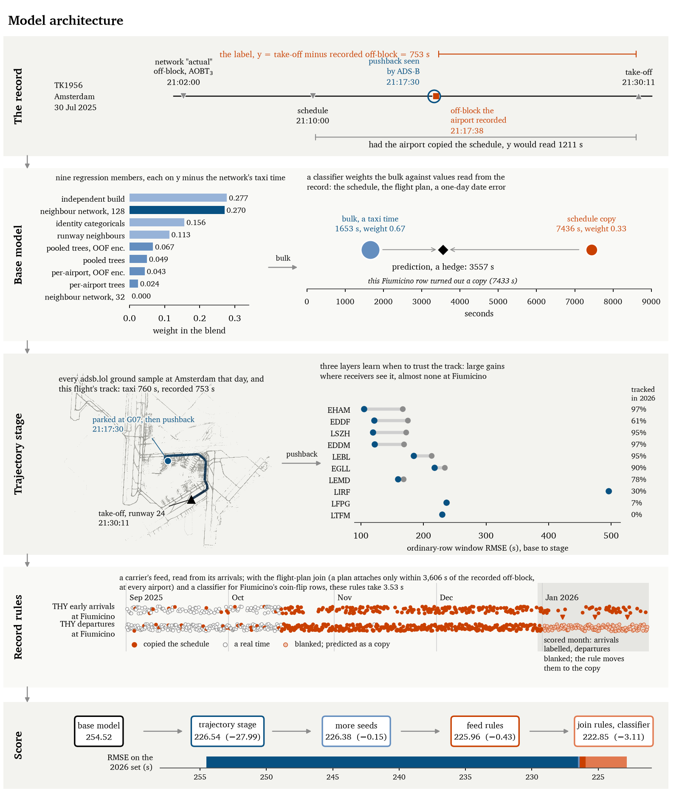

```
                         ______
                  ______/ o  o \____________________________________
    .   '  .      \   ====  Q U I C K - B O A T  ====    (FINAL)   /
  .  :' .:  .:'    \______________________________________________/
   ':  .:' .:' .:' ~~~~~~~~~~~~~~~~~~~~~~~~~~~~~~~~~~~~~~~~~~~~~~~~~~~~~~~~~~~~
~~~~~~~~~ PRC Data Challenge 2026 ~~ final model ~~ Jan/Jul 233.7464 ~~~~~~~~~~
     ~~       ~~~~~~~       ~~~~~~~       ~~~~~~~       ~~~~~~~       ~~~~~~~
```

# Taxi-out time prediction: PRC Data Challenge 2026, team `quick-boat`

Repository: https://github.com/arquicanedo/taxi-out-as-a-record. Paper: *Taxi-out Time as a Database Record*
(`analysis/joas/main.pdf`).

We predict `TAXITIME_SEC_mvt = MVT_TIME_UTC_mvt - BLOCK_TIME_UTC_mvt` for the departures of ten European airports,
scored by RMSE: 344,841 in January and July 2026 on the public leaderboard, and 670,790 over January, February, June
and July 2026 in the final phase. Take-off times are given and only the off-block time is hidden, so this is
reconstruction rather than forecasting. The finding everything else rests on: **the target is a bookkeeping difference
between two timestamps, not a physical quantity.** The off-block time is what each airport's system wrote down, and
when an airport does not know, it writes something else, most often the scheduled time. So the model has two jobs.
Where the record is a real pushback, measure it: a blend of nine regression members, plus a stage that reads the
aircraft's own ADS-B surface track. Where it is not, reconstruct what the system wrote: a mixture over schedule
copies and date errors, and rules read from how the records are made. The final model carries no value fitted to
leaderboard scores and **scores 233.7464 on January and July** (`FINAL.md`).

**Our entry is the final model** (`submissions/quick-boat_final.parquet`, all four months of the final phase; its
January and July rows scored 233.7464 as v130). Beside it ships **the competition model**, v126 (222.8507): the same
design pushed with everything the leaderboard offered. `REPRODUCE.md` section 9 lists the values fitted to
leaderboard scores, `FINAL.md` describes both files, and `analysis/COVER-LETTER.md` states how the leaderboard and AI
tools were used.

**Which number measures the method: 233.7464**, the final model's. The competition model's 222.8507 includes values
fitted to the leaderboard on the same months it is scored on, so it is not comparable and not a reference. The recording failures the paper characterises (schedule copies at Fiumicino, carriers whose data feeds fail, date errors and the flight-plan join) were found by studying its
errors, and the final model keeps them as rules whose evidence is labelled.

**Licence: GNU GPL v3** (`LICENSE`). **External data: `EXTERNAL-DATA.md`.** The final model contains information from
adsb.lol, made available under the ODbL 1.0, (c) adsb.lol contributors (`scripts/adsb/ATTRIBUTION.md`). **The paper:
`analysis/joas/main.pdf`** (source `main.tex`, the journal's template). **How we used the leaderboard: `analysis/COVER-LETTER.md`.**

**Use of AI.** The work was done with the Claude Code agent (Anthropic: Claude Opus 5 and 5.5, with Fable 5.1 and
Sonnet 5 subagents for independent review and verification). The agents wrote the code, ran the analyses and drafted
the documentation and the paper under the author's direction and review. Over the logged sessions, 8 September to
5 October 2026, the author directed them with 979 prompts in 16.5 hours of interaction, and the agents worked 143.6
hours, 68.7 of them in computation on one laptop. Every build is checked against the SHA-256 of the file we submitted,
and every number in the paper was traced to the measurement that produced it. The paper and `analysis/COVER-LETTER.md`
give the full statement.



*The model on real rows (`scripts/fig_model_architecture.py`): one departure's record, the nine members' blend
weights, the mixture on one hedged Fiumicino row, every adsb.lol ground sample at Amsterdam on 2025-07-30 with one
flight's track, the stage's effect by airport, one carrier's copied records at Fiumicino, and the competition model's
RMSE on the 2026 set after each part.*

## 1. The models in this repository

Each one is a parquet in `submissions/`, listed with its SHA-256 in `submissions/SHA256SUMS`, with the script that
rebuilds it (`MODELS.md`). **`scripts/verify.sh` checks them in under a minute with only the challenge data**: every
shipped file against its hash (the final model's files included), then v100 and v120 to v126 rebuilt byte for byte
from the archived inputs; `scripts/final/run_final.sh` rebuilds the final model (`REPRODUCE.md` section 14).

| Model | Name | RMSE | What it is |
|---|---|---|---|
| **final** | **final** | **233.7464** | the entry: the clean base, the chain's two labelled LIRF cells (v95, v96), the stage with its refitted weight, the rules of section 3.4 and LIRF day-scale bands, retrained once on four months (`FINAL.md`; January and July scored as v130; February and June without feedback) |
| v126 | competition (not the entry; includes leaderboard-fitted values) | 222.8507 | the stage below with its weight refitted, more seeds and seven rules read from how Fiumicino's records are made (section 3.4), on the base with the constants fitted to the leaderboard |
| v127 | clean + rules | 247.7412 | the same rules on the clean rebuild; pre-registered at 246.41 (`scripts/v127_build.sh`) |
| v114 | stage | 226.8129 | the base model plus the trajectory stage on adsb.lol surface tracks, as first submitted |
| v116 | clean stage | 268.1373 | the same stage on the clean base (`REPRODUCE.md` section 12) |
| v100 | base | 254.5228 | the base model: a nine-member blend and a hand-built chain for the tail, no trajectory data |
| v115 | clean base | 292.0485 | the base model's architecture with a learned gate for the tail instead of the hand-built chain |

The **clean** models and the final model carry no constant fitted to leaderboard scores (section 6 says what those
constants are). v126 and v127 apply the same rules to their two bases, so the 24.89 s between them is what the hand-built
tail chain and its fitted constants were worth, together with the extra seeds. The final model adds to v127 the chain's
cells whose evidence is labelled and recovers 13.99 of those seconds; the 10.90 s left holds the fitted constants, the
extra seeds, the chain's remaining cells and the retraining (`FINAL.md`). Terms used throughout (copy, hedge, cell, Q,
`FIRE=0`, the member names, the airport codes) are defined in section 8.

## 2. The idea the rest of it rests on

`BLOCK_TIME_UTC_mvt` is what an airport's own system wrote down, and different airports write different things when
they do not know. An organiser confirmed the premise directly:

> "_mvt columns come from airport according to movement phase... As everything in Aviation, all
> definitions come from ICAO...and everybody implements them its own way. Joking but not joking."
> (E. Spinielli, 2026-09-05)

That is why the tail is not a modelling problem in the usual sense. At Rome Fiumicino (LIRF) the system copies
`SCHED_TIME` into `BLOCK_TIME` when no actual off-block was captured, producing recorded "taxi times" of twelve hours
and more. We measured that the record is **physically impossible on 34.1% of the tail population** (the recorded
off-block predates the aircraft's own arrival), and that a hard physical constraint built from a 99.9%-accurate
airframe chain therefore *loses* 68.9 RMSE-seconds, because it clips true records down. A bookkeeping difference is not
bound by physics, and that single fact reorganised the whole approach.

## 3. The model

### 3.1 The base model: a blend for ordinary rows and a mixture for the tail

A blend of nine regression members predicts the ordinary taxi, as a residual around the network's off-block. The
blend weights are fitted **out of fold on labelled 2025 data**, on window versions of the members that ship, with
target encodings recomputed from the training months:

```
  pooled trees        .0494      per-airport trees          .0240      window net K=32    .0000
  window net K=128    .2703      identity categoricals      .1562      runway neighbours  .1131
  independent build   .2770      pooled / per-airport trees on out-of-fold encodings  .0667 / .0431
```

A mixture over the record's branches (a real taxi, a schedule copy, a date error one day off) covers the tail; a
classifier weights the branches row by row, and a hand-built chain applies them on the scored rows. **That chain
carries constants fitted to the public leaderboard before we stopped doing so**: seven scalars and three smaller
adjustments, listed in `REPRODUCE.md` section 9 and discussed in section 6.

### 3.2 The movement-window transformer

The member carrying the largest blend weight reads, for each departure, the **K nearest movements in time at the same
airport**, and attends over them. It uses each neighbour's **arrival taxi-in**, which is labelled on every row of every
file including the scored set, and **never a neighbour's departure label**, which is blanked. So it runs on the scored
months with no train/serve mismatch. Measured across the series, better on accuracy **and** on residual independence at
every step:

```
  K= 32   solo 230.941   corr vs blend 0.9495
  K= 64   solo 230.289                 0.9486
  K=128   solo 229.463                 0.9473
```

`scripts/arch/d3_multiscale.py` holds the token budget at 32 and changes only which neighbours fill it: contiguous
±16 beats a ±643 hybrid and a ±657 geometric ladder on both criteria. **K buys density, not horizon.**

### 3.3 The trajectory stage (v102 to v114)

Where an airport captured a real off-block, its record is the pushback, and the aircraft's own ADS-B track sees it. For
each departure the stage finds the aircraft's surface track in the adsb.lol archive (callsign and take-off within 300 s,
or take-off time alone within 60 s when each is the other's only candidate) and measures the pushback: the first
movement after a parked dwell, or the first sighting when the transponder comes on during the push. Three layers sit on
the base model, each priced on labelled 2025 data before it was submitted:

```
  layer 1   a residual stage on the base model, trained on January and July 2025: equal quarters of
            LightGBM, XGBoost, CatBoost and an MLP on 25 movement features
  layer 2   the pooled and per-airport tree members retrained with the trajectory features on all of 2025,
            replacing the base bulk (not stacked under it) on covered rows
  layer 3   a full-year stage (LightGBM + XGBoost) on month-fold out-of-fold residuals of layer 2
  final     layer 1 + 0.837 (layers 2 and 3 - layer 1) on covered rows; LIRF keeps layer 1 alone
            (0.662 in v114, refitted outside LIRF in v117)
```

It changes only rows with a detected pushback (60.9% of the scored set) where the base does not already predict the
schedule copy, it never touches the hedged tail, and it adds no constant fitted to the public leaderboard.

### 3.4 Rules read from the record (v117 to v126)

```
  v117   the stage's weight refitted on the window outside LIRF: 0.837 (January fit 0.834, July 0.840)
  v118   more seeds on the scored side, nothing refitted: K128 8 -> 18, CL 2 -> 10, L55A 3 -> 10
  v120   THY at LIRF: its own early arrivals were 38 of 38 copied in January 2026, its feed down as in
         November and December 2025, when 241 of 243 departures copied the schedule; its January departures
         move to 0.992 * copy + 0.008 * bulk
  v121   outage spans (runs of five or more copied early arrivals of one carrier) mark when a carrier's feed is
         down; departures inside a 2026 span move toward the copy, at the carrier's own 2025 rate if its
         departures followed its arrivals in 2025, at 0.731 if it is new, and not at all if they did not follow
  v122   the flight-plan join: a departure carries its plan only when |BLOCK - LOBT| <= 3606 s (exact over 2,062,577
         2025 departures). Predictions with a plan are clipped onto that interval; LIRF departures without one whose
         plan is recovered from their arrival at the destination, and which took off > 3606 s after it, are real
         (76 of 76 in 2025) and take the network's off-block of the same flight
  v123   a copy classifier for LIRF's no-plan, 1-4 h delayed coin flip (day counts, delay filing, carrier rates, the
         carrier's 2026 arrival copy rate), half-weighted against the model
  v124   the join's second case: no plan and a take-off within 3606 s of the recovered plan means an off-block more
         than an hour before it, a floor; above it, 21 of 23 such 2025 rows were copies
  v125   LIRF's local-time record class: some carriers' no-plan, near-on-time departures carry an off-block one UTC
         offset early (y = taxi + 3600 / 7200 s); a class mixture with rates counted on 2025
  v126   LIRF departures without a plan delayed 30,000 to 86,000 s were never real in 2025 (36 copies, 9 date
         errors): clip(ms) below 46,800 s, a floor at ms above; corrupted (repeated-designator) identifiers left out
```

Every rule's evidence is labelled 2025 data, or the 2026 arrivals in the scored file, which keep their labels; no
scored departure's label is read. Each was pre-registered with a predicted score before it was submitted. v122 to v126
were found by a separate AI agent session given only the challenge's files (`scripts/fable_lirf/`); the join rule was
re-derived with independent code before it was built. Together they took the public score from 225.9576 to 222.8507.

### 3.5 Component admission

A second component improves a blend only when `sigma_2 < sigma_1 / rho`. Applied to six feature families that had each
been closed for failing to improve a single model, the result inverted the expectation: every one was **far more
independent** than anything we ship (0.58–0.72 against 0.9473) and every one still failed, because all were too weak.
**Independence was never the binding constraint; strength was.**

## 4. What we measured that bounds the problem

- **Offline gains were mispriced by the estimator, not lost in transfer.** A bulk change validated at
  1.442e8 of squared error paid 1.407e7. Pricing a member's own gain times its blend weight counts error
  the blend already averages out, and it was priced against members that were not in the blend. Priced
  at the deployed level with the scored-set perturbation charged in full, the next change (v100) was
  predicted before submission and paid 0.67 standard errors above the estimate.
- **The published score is dominated by ordinary rows.** The validation window's tail share (40%) comes
  from two unrecoverable day-scale records; without them the window matches the public score within 4.5%.
- **The network's "actual" off-block is a computed buffer at six of ten airports**: take-off time minus a
  stand-and-runway standard taxi time. There the strongest feature carries a lookup, not the flight.
- **Above roughly 45 minutes a recorded taxi is mostly not a taxi**: the airport's off-block is 30+ minutes
  before the network's, and 66% of those records are logged within 15 minutes of schedule.
- **A sensor that measures reality helps exactly where the record is reality.** The trajectory stage took the
  public score from 254.52 to 226.54 and gained least at LIRF, whose errors are records; there the competition
  model keeps its simplest layer. At LIRF the gain came instead from the records: a carrier's failing feed, read from the
  scored months' labelled arrivals, and the flight-plan join, wherever it succeeded and at LIRF even where it failed,
  took the competition model to 222.85. 39.1% of scored departures have no surface track (all of LTFM, nearly all of LFPG),
  and the receiver network, not the matching, sets that limit.
- **The validation window prices transfer across seasons, not across years.** Two changes whose inputs moved
  between 2025 and 2026 (weather by month, receiver geometry) priced positive on labelled 2025 data and lost on
  the board. Tree-learner changes on the aircraft's movement features paid 1.03 to 1.97 times their offline
  estimate, the high end where 2026 coverage outgrew 2025's.

## 5. Reproduce

1. **Environment.** Install `uv` and `export UV_EXCLUDE_NEWER=2026-10-02T00:00:00Z`, which resolves every unversioned
   `uv run --with` to the library versions in `requirements.txt` (`requirements-lock.txt` pins every package;
   `.python-version` selects Python 3.13; `REPRODUCE.md` section 0).
2. **Data.** Set `DC26_DATA` to the challenge extract (the 2026-09-04 reissue) and `DC26_WORK` to a scratch directory;
   both are required. `DC26_TMP` (default `/tmp`) holds intermediates and `DC26_SESSION` (default `$DC26_WORK/session`)
   the v100 member work. Copy `artifacts/*.parquet` into `$DC26_WORK` and `artifacts/full_package.npz` into
   `$DC26_SESSION/p2P`. `scripts/pull_opdi.py` fetches OPDI; the PRU snapshot the model used is in `reference/pru/`.
3. **Check, in under a minute.** `scripts/verify.sh` (with only `DC26_DATA` set) checks every shipped file against
   its sha256, then rebuilds v100 and v120 to v126 twice each: `FIRE=0` must write the base back byte for byte, and
   the build must write its own submission byte for byte. It writes nothing inside the repository.
4. **The final model.** `scripts/final/run_final.sh` builds it on the four months of `final_ranking.parquet`, in twelve
   resumable steps from the raw extract (`FINAL.md`: inputs, steps, the value behind each constant; the 2026-10-08 build took
   8 h 9 min of wall time on one laptop, the 128-neighbour network on its GPU the longest step). The neural members re-draw, so the shipped files are
   tracked with their sha256.
5. **The competition model.** `TAIL=1 scripts/reproduce_final.sh` rebuilds v120 to v126 from the tracked v118 and the
   archived members and seeds, in seconds. With the v114 inputs in place (the adsb.lol tables, step 5),
   `scripts/reproduce_final.sh` rebuilds v118 from the archived seeds first (`DRY=1` prints the plan).
6. **Everything else**, from the raw extract up, by deliverable:

```
v100     uv run --quiet --with pandas --with numpy --with pyarrow python scripts/v100_build.py
         -> submissions/quick-boat_v100.parquet
            sha256 30ca298a56825a78762312936b39229f32c1fdc7dab2659ecd7f69957f939332
            reads the tracked v99 and the archived bulk members (artifacts/); byte-identical, verified 2026-09-23

v114     PULL=1 FROM_DAYS=1 scripts/regen_adsb.sh
            once: streams 427 days from adsb.lol (network-bound, hours), rebuilds the feature tables and checks
            them against their content hashes, then builds v102 -> v114
         scripts/regen_adsb.sh
            afterwards: v102 -> v114 from those tables, no network
         -> every submission from v102 to v114, each asserted against the shipped file
            v114 sha256 7ec3f9d66202f64766d087512cea26aa945fa08eb541b2853033fdbc84381e2b

final    scripts/final/run_final.sh      the four months of final_ranking.parquet, steps 1 -> 12 (FINAL.md)
         -> submissions/quick-boat_final.parquet (the entry) and quick-boat_final_with_v126.parquet
            final sha256 97f3819fcc04c1f4f2994acaaeb509fa89315944841c5340fcfb8b3109df9cab
            with_v126 sha256 16cfd173334db2ae9d28924217a04047700d739965d36f380a175e121dbca2f9

v126     scripts/reproduce_final.sh      v118 from the archived seeds, then v120 -> v126
            needs the v114 inputs above (the adsb.lol tables and v15_rk_jul19.parquet)
            inputs of v123 and v125 archived in artifacts/fable/ (scripts/fable_lirf/run_all.sh regenerates them)
            v126 sha256 d66768fe3504ddcc6ed0bbf9a0e97bfff5d9e353e73bc4e4a4b170a079b6a951

clean    scripts/regen_clean.sh         the clean base and v102 -> v114 in CLEAN mode, into $DC26_WORK/clean
         scripts/v115_v116_build.sh     -> submissions/quick-boat_v115.parquet, quick-boat_v116.parquet
            v115 sha256 00bf453efc80d6d5805332ef81c3becde0d28da0e8ad7f35a2ad622009ebf8e4
            v116 sha256 a460c540c9d36e7930b2695f8b1c30533b70bcba5c21de14a8baa1884257a9c7
            two runs byte-identical, verified 2026-09-30
         scripts/v127_build.sh          v116 + the rules of v120 -> v126 -> submissions/quick-boat_v127.parquet
            v127 sha256 74fcf296d1ee90b08cfa6ce7b7356a8b82143ccf51dd2b87e1754925938f4d12

rebuild  DRY=1 scripts/regen2.sh        raw extract -> the shipped members and the chain to v76 (13 stages)
         DRY=1 scripts/regen_chain.sh   the window artefacts v84 reads, then v79 -> v99
         DRY=1 scripts/regen_v100.sh    the five new bulk members -> v100 (1 to 2.5 h on 18 cores)
```

The adsb.lol-derived feature tables are not redistributed here (ODbL 1.0: we ship the method that builds them, and
their content hashes), which is why v114 starts with the pull. `regen_adsb.sh` also needs `v15_rk_jul19.parquet` in
`$DC26_WORK` (`ONLY=1 scripts/regen2.sh`, then `ONLY=2 scripts/regen2.sh`, which writes it to `$DC26_TMP`; copy it from there into
`$DC26_WORK`) and puts every other input it reads in place itself
(`REPRODUCE.md` section 11). `REPRODUCE.md` documents what the scripts do not say: the settings applied from other
files, the data-extract traps, the lineage `v64 -> ... -> v99 -> v100`, and the constants fitted to the public
leaderboard (section 9). Earlier deliverables (v74, v76, v79) remain buildable and tracked.

## 6. Limits of this repository, stated plainly

- **`quick-boat_v29.parquet` is an archived input, not a rebuilt one.** It is the calibration base
  of the chain and no script ever produced it. `scripts/v29_build.py` recovers its form exactly
  (base `v23`, alpha 0.35, identified by least squares against every shipped file) and reproduces
  it to **0.00069 RMSE-seconds**; the residual is 1,592 rows off by exactly 1 s because the
  original blended unrounded predictions while the archived inputs are already `int32`. On a fresh
  extract that rounding does not arise and the path is exact.
- **Reproducing from raw data takes about 17 machine-hours in all, most of it `regen2.sh` (10 to 14 h), and does not
  come out bit-identical**, and the reason is measured rather than assumed. Every production stage was re-run on
  2026-09-23 from an empty work directory, one stage at a time, and compared with the original (`REPRODUCE.md`
  section 10). The feature tables, the tree models, the classifier, the window data and the OPDI features reproduce
  **exactly**. The neural components (the MLPs and the window transformers, on Apple Metal; `scripts/arch/harness.py`
  also selects CUDA, and CPU training is untested) re-draw on every run: a
  rebuilt K=128 differs from the shipped one by RMS 41 s. Some LightGBM members drift because LightGBM times its
  histogram strategy at run time, and one member's early stopping amplifies that to RMS 12 s. Worst of all, v64
  reconstructs the archived v29's mixture weights through the MLP, so a re-drawn MLP moves the chain by RMS 30 s. So
  **`artifacts/` ships the neural predictions the chain reads (our own outputs on the scored rows), and the drivers pin
  them** after each re-draw (`USE_REDRAWN=1` opts out). With the archive, v91 through v100 rebuild byte-identically;
  with everything re-drawn, v100 differs from the shipped file by RMS 9.8 s on 281,014 rows.
- **OPDI's upstream licence wording is ambiguous**: the portal states both attribution-only reuse
  and a non-commercial focus, with no licence file. Asked in the competition channel whether OPDI
  counts as open data for prize eligibility, an organiser answered "yes open" (2026-10-04). The
  details are in `EXTERNAL-DATA.md`. Its measured contribution is +0.0533.
- **Part of the public-board standing came from fitting to public scores.** We submitted
  perturbations on known row sets, read the score change, solved for the optimum and shipped it. We
  stopped on 2026-09-11 after an organiser wrote that reverse-engineering the ranking is despised. The
  resulting constants, seven scalars and three smaller adjustments, are itemised in `REPRODUCE.md` section 9.
  Removing most of them costs **2.7501 RMSE-seconds, measured** (v76 against v74); three stay in both arms of that
  comparison, so the full contribution is larger. The retired probe scripts are published
  deliberately (`scripts/v45_build.py`, `scripts/v57_probe.py`, marked RETIRED), and the paper discusses them. The cover
  letter (`analysis/COVER-LETTER.md`) states in full how the leaderboard was used and what it was worth, and how the
  work was done with AI tools.
  v114 to v126 inherit them through their base; the trajectory stage adds none, and the bulk the v120 and v121 rules
  blend with carries the base's month offsets. The clean models (v115, v116, v127) and the final model carry none.
- **The trajectory feature tables are not in this repository.** They are derivative databases of adsb.lol
  (ODbL 1.0). We ship the scripts that rebuild them from the archive's public daily releases, and their content
  hashes (`artifacts/adsb_push_feat.content.sha256`), as ODbL section 4.6(b) allows. Rebuilding them streams all
  427 days; nothing raw is stored, and a release adsb.lol withdraws cannot be rebuilt. The member predictions
  trained on them are archived (`artifacts/adsb_window/`). Rebuilt tables are placed with exactly the archived
  columns and equal the archived tables in content, from which v102 to v114 rebuild byte-identically (verified in
  the author's tree). Retraining the full-year members from scratch takes hours and
  can drift slightly (multithreaded LightGBM); `V110_ALLOW_DRIFT=1` and `V112_ALLOW_DRIFT=1` let those builds
  finish and report the difference.
- **The validation-window files ship without labels.** `scripts/p1a_instrument.py` reads the window's labels from
  your challenge extract, so nothing here redistributes challenge data.

## 7. Layout

```
  scripts/verify.sh                        the two-minute check: hashes, then v100 and v120 -> v126 byte for byte
  scripts/final/run_final.sh               THE FINAL MODEL, four months, twelve steps (FINAL.md)
  scripts/final/                           its parts: seam_rules.py, lirf_dayscale.py, splice_final.py, read3_build.py
  scripts/reproduce_final.sh               the competition model, v126, in one command (TAIL=1: v120 -> v126 in seconds)
  scripts/regen_adsb.sh                    the trajectory stage, v102 -> v114, sha-asserted
  scripts/regen_seeds.sh  v118_build.sh    v100 -> v117 again with more seeds -> v118
  scripts/v117 v119-v126_build.py          the last builds, each asserting its base and its own sha
  scripts/fable_lirf/                      the join-rule and classifier pipeline, from the challenge files only
  scripts/v127_build.sh                    the clean rules: v116 plus the rules of v120 -> v126
  scripts/paper_final_window.py            the competition model on the labelled window (the paper's window numbers)
  scripts/adsb_stream_day.py  adsb_pull_all.sh  adsb_pull_year.sh   stream and parse the adsb.lol days
  scripts/adsb_push_features.py  adsb_feat_hash.py                   the pushback feature tables, and their hashes
  scripts/p2p_v55_adsb.py  overnight_v110.sh  oof_folds_v112.sh      the full-year members (layers 2 and 3)
  scripts/adsb_price*.py  adsb_stage_*.py  adsb_v110_diag.py  stage_mlp*.py   the stages, each priced before it shipped
  scripts/v102_build.py ... v114_build.py  one build per submission, each asserting its base and its own sha
  scripts/v100_build.py                    the base model's final build: v99 with the refitted bulk
  scripts/regen2.sh  regen_chain.sh  regen_v100.sh   raw extract -> members -> chain -> v100. DRY=1 first
  scripts/v84 v90 v91 v95 v96 v99_build.py the chain from v79 to v99, each asserting its input sha
  scripts/p2p_*.py                         v100's bulk members (window and ranking side) and pricing
  scripts/v64_build.py                     the prediction chain, with its byte-identical control
  scripts/v29_build.py                     the calibration base, and what is recoverable of it
  scripts/features.py  v17_features.py     feature construction, one definition for train and score
  scripts/gate_a2.py                       the tree components and the tail classifier
  scripts/arch/                            the movement-window transformer and its ablations
  scripts/pull_pru.py  pull_opdi.py        external data
  scripts/presubmit_guard.py               refuses a submission whose evidence does not match
                                           where its error mass moved
  artifacts/                               archived members and neural predictions the exact builds read;
                                           artifacts/adsb_window/ the trajectory stage's archived inputs;
                                           artifacts/seeds/ the extra seeds v118 averages
  analysis/joas/                           the paper: main.tex (the source, JOAS template), main.pdf, reference.bib
  analysis/COVER-LETTER.md                 how the leaderboard was used and what it was worth; use of AI
  analysis/RESEARCH-LOG-INDEX.md           what each research-log section cited in the code established
  REPRODUCE.md  MODELS.md  MANIFEST.md  EXTERNAL-DATA.md  requirements.txt  requirements-lock.txt  LICENSE
```

`scripts/presubmit_guard.py` is worth one line of explanation: it decomposes a candidate's change against its base,
and refuses to ship a tail-population edit justified by offline validation, because we have measured that offline
validation mispredicts the **direction** of tail-side changes. It was written after that mistake cost us 3.00
RMSE-seconds.

## 8. Glossary

The scripts and `REPRODUCE.md` use a few terms of their own.

```
  y, the target      MVT_TIME - BLOCK_TIME in seconds, the recorded taxi-out
  ms                 MVT_TIME - SCHED_TIME: what y would be if the off-block record were the schedule
  copy               a record whose off-block is the scheduled time (y = ms); the schedule fallback
  date error         a record one day off (y = taxi + 86,400 s)
  tail, extreme      a row with y >= 7,200 s
  bulk               the regression blend for ordinary rows (section 3.1)
  hedge              a prediction that mixes two hypotheses, such as p * copy + (1 - p) * bulk
  cell               a set of rows defined by a predicate, such as LIRF departures with no plan and ms > 3,600 s
  commit             set a cell's rows to one hypothesis instead of hedging
  the window         January and July 2025, scored out of fold: the labelled stand-in for the 2026 set
  the 2026 set       the 344,841 scored departures, January and July 2026
  board, public score  the leaderboard's RMSE on the 2026 set
  Q                  the squared size of a change, sum of (new - old)^2 over the rows it moves
  dSSE               the change in summed squared error; a change "pays" when dSSE < 0, and dSSE = -Q when every
                     moved row lands exactly on its truth
  FIRE=0             run a build without its change: it must write its base back byte for byte
  members            L55, P55 pooled and per-airport trees; K32, K128 window transformers; ID identity
                     categoricals; RQ runway neighbours; CL the independent build; L55o, P55o trees on out-of-fold
                     encodings; L55A, P55A their trajectory-feature versions (layer 2)
  LOBT, IOBT, AOBT_3 the flight plan's, the network's initial and the network's actual off-block times
  the join           whether a departure row carries its flight plan's columns
  CHAR(8)            a corrupted identifier: the airline designator repeated to pad the flight number to eight
                     characters
  sNNN               a section of our internal research log, cited in code comments; the log is not published, and
                     analysis/RESEARCH-LOG-INDEX.md gives every cited section's date and what it established
  LIRF, LFPG, ...    ICAO airport codes: EDDF Frankfurt, EDDM Munich, EGLL Heathrow, EHAM Amsterdam, LEBL
                     Barcelona, LEMD Madrid, LFPG Paris-CDG, LIRF Rome Fiumicino, LSZH Zurich, LTFM Istanbul
```
